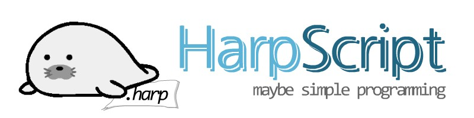
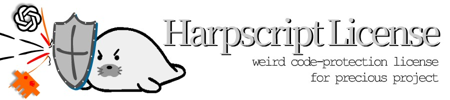

# Harp Script v0.1.1

**Documentation In progress**

*HarpScript for simple programming*




## Usage

0. Go to Release Page, Download `HarpScriptv0_1_1.zip`.

1. Write your code, and remember the path and file name.

2. Run harp.exe, or write commands
```bash
$ harp run src/main.harp
```
3. Bytecode will be generated, and vm runs. Happy coding ;)

4. if you want help, type below. And read the docs please.
```
$ harp help
$ harp -help
$ harp --help
$ harp -h
$ harp --h
```

## LICENSE
Until `v0.1.0` : `Apache License 2.0` <br>
After `v0.1.1` : `HarpScript License` (will explain it later.)




## Info
- [Korean/한국어판 README_KR](README_KR.md)
- First Developed (v0.1.0): ~December 2018
- Remake Idea: April 2026~
- v0.1.1 : August 2026 ~ December 2026 (Planned)
- Status: Experimental
- `no ai use - nok project`

## Introduction

Harp Script is a simple, script-style programming language, developed around 2018.

The goals of Harp Script are as follows:

- escape from stereotype of toy script
- Simple syntax, flexible syntax usage
- Uncomplicated parser
- Lightweight and extensible VM
- Reference Counting, Reduce dependency on memory GC (ex : Mark sweep Algorithm)

## NOTICE
This repository is mainly for introduction and explanation, and the code has not been uploaded. Codeberg Instead.
https://codeberg.org/Noksek/harp_script

## Philosophy?
- Easy to implement, use it for a long time.
- Limited functions require thinking ability.
- Basic functions, no complicated functions.
- Code style is up to you.
- Typing errors are up to you.


## Latest Version (v0.1.1)
- Complete redesign
- Modify Program Structure (VM, Compiler, Types... else)
- Modify grammar

## Features

- Limited functionality

- Simple math operations

- Minimal built-in function support

- Minimal Basic data types

- Minimal and lightweight Dynamic array(`List`), HashMap(`Dict`)

- Minimal object support, for low-latency, no memory-GC

- DLL/SO loading for direct C language interoperability(FFI, `cfunc`)

- Simple language management system inspired by Go

## Codeberg, Please...
- **Hosted on Codeberg** : To prevent unauthorized AI data harvesting, please contribute or fork via Codeberg. If using GitHub, keep your forks private.


## Examples & Syntax

Please refer to the files inside the example folder for syntax references and examples.
- [LANG_SPEC/English](LANG_SPEC_EN.md)
- [LANG_SPEC/한국어](LANG_SPEC_KR.md)


## Implementation Features
* **Simple FFI (Foreign Function Interface):** Uses WinAPI (`LoadLibrary`/`GetProcAddress`) to dynamically load `.dll` files (e.g., `DxLib.dll`). These are wrapped as built-in functions that can be called directly from the VM.
* **Stack-Based VM:** A simple stack-based virtual machine, written in C++, interprets and executes the bytecode.
* ** Direct-to-Bytecode or Simple AST (later):** Does not build an explicit Abstract Syntax Tree (AST). A recursive descent parser with an operator-precedence stack generates bytecode directly during parsing. 
