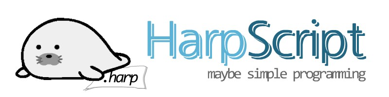
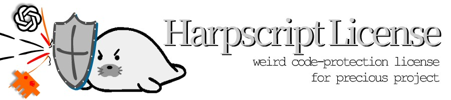

# Harp Script v0.1.1

**문서 작업 중**

*HarpScript for simple programming*



## 사용 방법

0. 릴리스 페이지로 이동해 `HarpScriptv0_1_1.zip` 파일을 다운로드하세요.

1. 코드를 작성하고, 경로와 파일 이름을 기억해 두세요.

2. `harp.exe`를 실행하거나 아래 명령을 입력하세요.
```bash
$ harp run src/main.harp
```
3. 바이트코드가 생성되고 VM이 실행됩니다. 행복하게 코딩하세요 ;)

4. 도움이 필요하면 아래 명령을 입력하세요. 문서도 꼭 읽어보세요.
```bash
$ harp help
$ harp -help
$ harp --help
$ harp -h
$ harp --h
```

## 라이선스
Until `v0.1.0` : `Apache License 2.0` <br>
After `v0.1.1` : `HarpScript License` (추후 설명 예정)



## 정보
- [영문 README](README.md)
- 최초 개발 (v0.1.0): 2018년 12월경
- 리메이크 아이디어: 2026년 4월 이후
- v0.1.1: 2026년 8월 ~ 2026년 12월 (예정)
- 상태: 실험 단계
- `no ai use - nok project`

## 소개

Harp Script는 2018년경에 개발된 간단한 스크립트 스타일 프로그래밍 언어입니다.

Harp Script의 목표는 다음과 같습니다:

- 틀에 박힌 장난감 스크립트의 고정관념에서 벗어나기
- 단순한 문법, 유연한 문법 활용
- 복잡하지 않은 파서
- 가볍고 확장 가능한 VM
- 참조 카운팅을 사용해 메모리 GC 의존성 줄이기 (예: Mark Sweep 알고리즘)

## 공지
이 저장소는 주로 소개와 설명용이며, 코드가 업로드되지 않았습니다. 대신 Codeberg를 사용합니다.
https://codeberg.org/Noksek/harp_script

## 철학?
- 쉽게 구현하고 오래 사용할 수 있어야 함
- 제한된 기능은 생각의 힘을 요구함
- 기본 기능 위주, 복잡한 기능은 배제
- 코드 스타일은 사용자가 정함
- 타입 오류 역시 사용자가 책임짐

## 최신 버전 (v0.1.1)
- 완전한 재설계
- 프로그램 구조 수정 (VM, Compiler, Types 등)
- 문법 수정

## 기능

- 제한된 기능

- 간단한 수학 연산

- 최소한의 내장 함수 지원

- 최소한의 기본 데이터 타입

- 경량 동적 배열(`List`), 해시맵(`Dict`) 지원

- 저지연, 메모리 GC 없이 동작하도록 최소한의 객체 지원

- DLL/SO 로딩을 통한 직접 C 언어 상호운용(FFI, `cfunc`)

- Go에서 영감을 받은 간단한 언어 관리 시스템

## Codeberg, 부탁드립니다...
- **Codeberg 호스팅**: 무단 AI 데이터 수집을 방지하기 위해, 기여하거나 포크할 때는 Codeberg를 이용해 주세요. GitHub를 사용할 경우, 포크는 비공개로 유지해 주세요.

## 예제 및 문법

예제 폴더 안의 파일을 참고하면 문법 및 예시를 확인할 수 있습니다.
- [LANG_SPEC/English](LANG_SPEC_EN.md)
- [LANG_SPEC/한국어](LANG_SPEC_KR.md)

## 구현 기능

* **단순한 FFI (Foreign Function Interface)**: WinAPI (`LoadLibrary`/`GetProcAddress`)를 사용해 `.dll` 파일 (예: `DxLib.dll`)을 동적으로 로드합니다. 이 파일들은 VM에서 직접 호출할 수 있도록 내장 함수로 래핑됩니다.
* **스택 기반 VM**: C++로 작성된 간단한 스택 기반 가상 머신이 바이트코드를 해석하고 실행합니다.
* **직접 바이트코드 생성 또는 간단한 AST (추후)**: 별도의 추상 구문 트리(AST)를 만들지 않습니다. 연산자 우선순위 스택을 사용하는 재귀 하강 파서가 파싱 중에 바이트코드를 직접 생성합니다.

## 추가 설명

이 프로젝트는 간단하고 실험적인 스크립트 언어를 목표로 하며, 문법과 VM 설계는 점진적으로 바뀔 수 있습니다.
